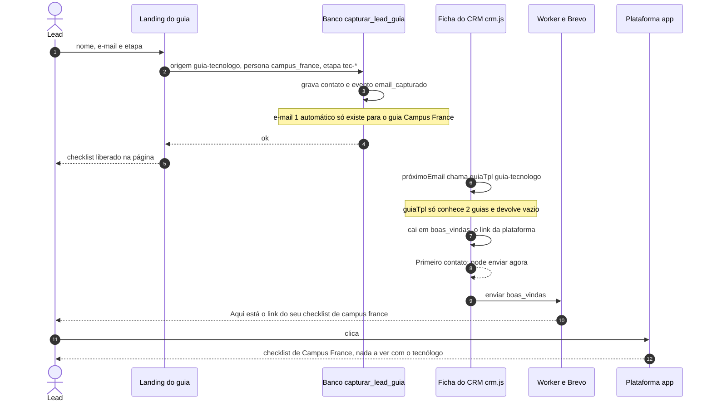
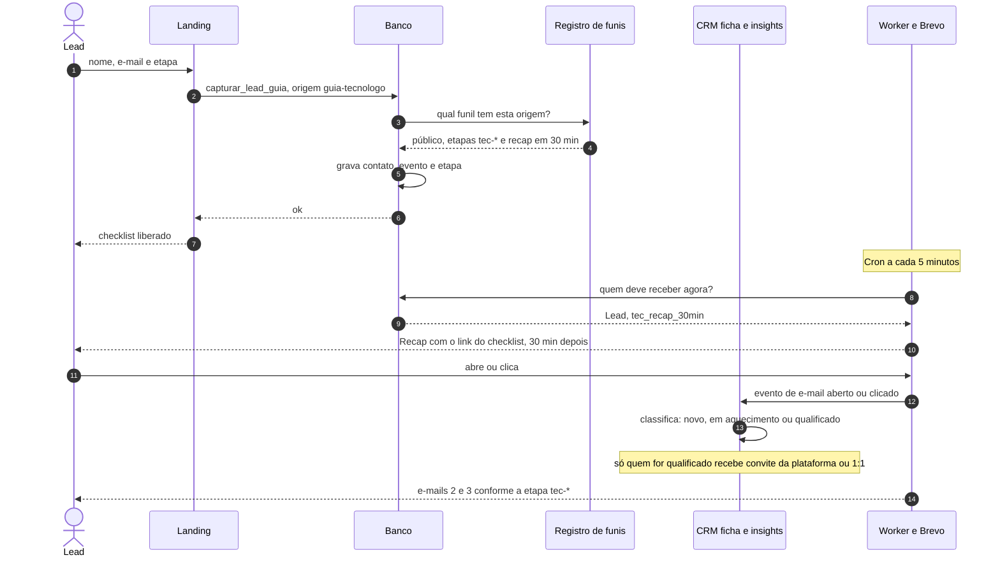
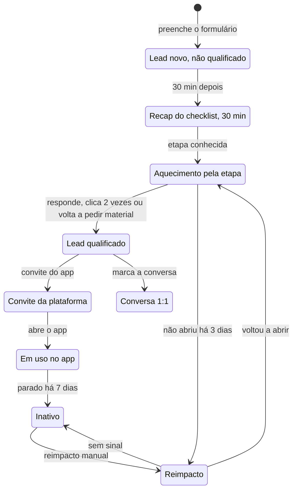
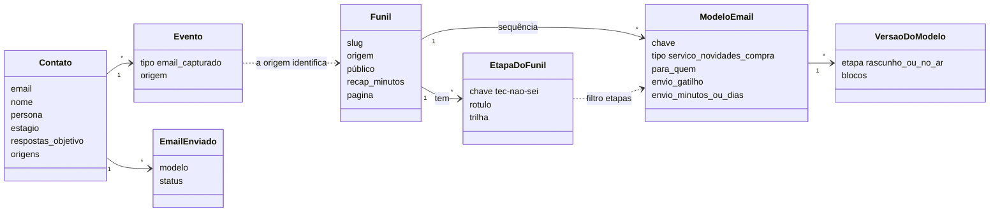
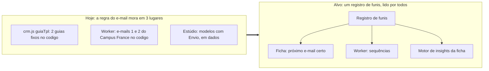
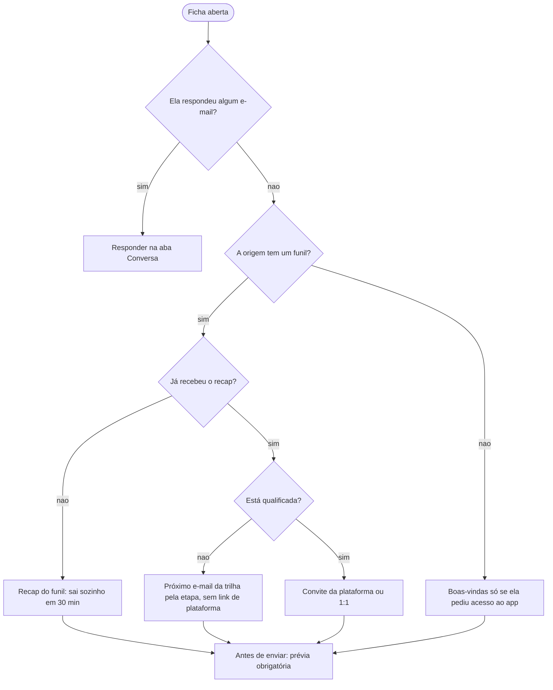

# Mapa de e-mails do CRM (2026-11-04)

> Documento de desenho, **não é código**. Mostra como o lead que preenche um guia vira e-mails no CRM hoje, o que deu errado com o guia do tecnólogo e o que muda. Os diagramas são Mermaid (o GitHub desenha). As imagens prontas estão no Notion.

## O problema, em uma frase
Um lead que **acabou de chegar** (ainda não qualificado) recebeu o e-mail de acesso à plataforma, com o "checklist de campus france", porque a ficha não reconhece o guia do tecnólogo e cai nas boas-vindas. A regra de "qual e-mail para qual público" mora em 3 lugares, e dois deles não sabem do guia novo.

## Por que aconteceu (no código)
- `admin/crm/crm.js`, `guiaTpl(origem)`: só conhece `guia-vls-ts` e `guia-email-alt30`. Para `guia-tecnologo` devolve vazio.
- `defaultTpl(c)` então usa `boas_vindas` (o link da plataforma, "{checklist de <persona>}"). `proximoEmail()` mostra "Primeiro contato: pode enviar agora" e o botão envia sem a pessoa ver o que vai.
- O banco só pede o e-mail 1 automático para o guia Campus France (`crm_guia_email_pedir`).
- O guia do tecnólogo grava `persona = campus_france`, e isso faz o texto e o link da plataforma falarem de Campus France.

## 1. Hoje: o que aconteceu

## 2. Alvo: do formulário ao e-mail certo

## 3. Estados do lead e do e-mail (alvo)

## 4. Modelo de dados: registro de funis (alvo)

## 5. Onde mora a regra do e-mail

## 6. Decisão do próximo e-mail na ficha (alvo)

## 7. Mapa de e-mails por origem

| Origem | Público | E-mails hoje | O que falta |
|---|---|---|---|
| `guia-etudes-en-france-2027` | Campus France, etapas `cf-*` | `cf_guia_1` (na hora, pede o Vault configurado), `cf_guia_conversa` (D+1 10h), `aq_a/b/c` D+3, D+6, D+10, D+15 pela etapa | Aquecimento nasceu em rascunho com o Envio desligado; `aq_c_d10` pede o link do presente CF09 e os D+15 as 3 dúvidas mais comuns |
| `guia-vls-ts` | Já na França, prazo de 3 meses | `guia_chamada`, `guia_plataforma`, `lembrete_prazo_vlsts` (todos manuais) | Sem sequência automática |
| `guia-email-alt30` | Alternância depois dos 29, etapas `alt-*` | `guia_alternancia` (manual, customizado pela etapa) | Sem recap e sem sequência |
| `guia-tecnologo` | Tecnólogo do Brasil, etapas `tec-*` | `tec_recap_30min` (pronto, falta ligar) | A ficha sugere `boas_vindas`; e-mails 2 e 3 por etapa não existem |
| Compra: Hub de Estudos | Comprou o Hub | `hub_estudos_compra`, `hub_estudos_d3`, `hub_estudos_lancamento` (manual) | Depende de registrar a compra na ficha |
| Sem guia (instagram, bot, blog, direto, artigo) | Funil geral ou artigo | `boas_vindas`, `naoabriu`, `naoclicou`, `cliquenaoapp`, `parouapp` (manuais) | Boas-vindas só faz sentido para quem pediu acesso ao app |

## 8. O que muda, em ordem (para aprovar)
1. **Registro de funis** (uma tabela): para cada origem, o público, as etapas, o e-mail de recap e a trilha. A ficha, o Worker e o motor de insights leem dele. É SQL e segue a regra de isolamento (teste do sentinela, staging, produção).
2. **Ficha** (`crm.js`): `guiaTpl` passa a ler do registro; lead de funil nunca recebe `boas_vindas` nem link de plataforma como primeiro contato; **prévia obrigatória** (assunto, corpo e para onde o link vai) antes de qualquer envio.
3. **Qualificação** calculada no banco, usada pelo motor de insights. Proposta de regra: qualificado = respondeu um e-mail, **ou** clicou em 2 ou mais e-mails, **ou** voltou a pedir material, **ou** marcou 1:1. Só qualificado recebe convite da plataforma ou do 1:1.
4. **Persona do lead do tecnólogo**: não gravar `campus_france` no cadastro do guia; a persona entra quando a pessoa pede a plataforma.
5. **E-mails 2 e 3 do tecnólogo** por etapa (`tec-*`), depois do recap.

## Implementado: registro de funis e e-mail por etapa (guia do tecnólogo)

- `admin/crm/funis.js` é o registro: para cada origem de guia (`guia-tecnologo`, `guia-etudes-en-france-2027`, `guia-vls-ts`, `guia-email-alt30`) diz as etapas, o modelo manual e, nos guias automáticos, o e-mail do guia + a trilha por etapa. A ficha (`crm.js`) lê dele: quem chega por um guia automático **nunca** recebe a sugestão de boas-vindas com o link da plataforma; a ficha mostra "o e-mail do guia sai sozinho em 30 min" (ou avisa que o Envio está desligado).
- Tecnólogo: 4 etapas (`tec-nao-sei`, `tec-juntando`, `tec-escrevi`, `tec-resposta`). O 1º e-mail (`tec_recap_30min`, 30 min depois) já fala da etapa marcada; 3 dias depois sai o e-mail só daquela etapa (`tec_d3_*`, só para quem aceitou novidades).
- Ativar, nesta ordem: `crm-sequencia-minutos.sql` → `crm-modelo-tecnologo-recap.sql` → `crm-modelos-tecnologo-etapas.sql` → `crm-modelos-prontos.sql` (catálogo de variáveis) no Supabase de teste e depois no de produção; colar o `worker.js`; cron `*/5 * * * *`; no Estúdio, revisar, publicar e ligar o Envio dos 5 modelos.
- Testes: `npm run test:funis`, `test:tecnologo`, `test:minutos` (em `admin/crm/db/testes`, com `APP_DB_DIR` apontando para `db/` do app).
- Próxima fase: registrar Campus France, alternância 30+ e VLS-TS com recap + trilha por etapa (mesmo desenho), e a regra de qualificação antes de convidar para a plataforma.
